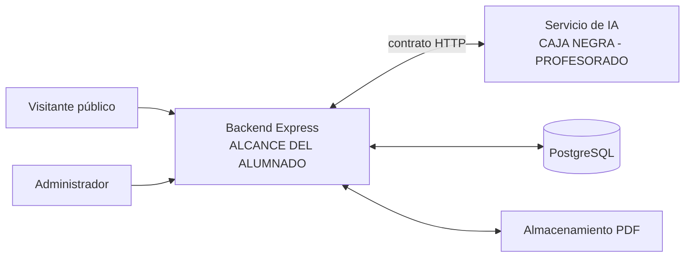

# Topic 01 — Arranque del proyecto

Bienvenida y bienvenido al proyecto de la asignatura de **Desarrollo Web en
Entorno Servidor** (DSW). Esta primera topic no escribimos aún ningún
backend; sentamos las bases para trabajar en equipo durante todo el curso:
entendemos qué vamos a construir, con quién, sobre qué herramientas y con
qué flujo de trabajo.

> **Idioma**: las explicaciones pedagógicas están en español. Los
> identificadores técnicos (`node`, `git`, `main`, nombres de rutas y de
> ficheros) van en inglés.

## Objetivos de aprendizaje

Al finalizar este topic serás capaz de:

- Explicar en lenguaje claro el sistema completo que vamos a construir.
- Distinguir qué partes son responsabilidad del alumnado (backend Express) y
  qué partes son responsabilidad del profesorado (servicio de IA como caja
  negra).
- Enumerar los dos tipos de usuario público y administrador del sistema.
- Verificar que tu entorno de desarrollo funciona (Node.js ≥ 20.19 y Git ≥ 2).
- Completar el ciclo Git básico: clonar → crear rama → confirmar cambios →
  publicar → abrir *pull request* → recibir revisión → integrar.
- Producir en equipo un diagrama de contexto del sistema y un backlog
  inicial de trabajo.

## Prerrequisitos

- Ninguno técnico: esta es la primera topic del curso.
- Acceso a un ordenador (portátil personal o equipo de aula) donde puedas
  instalar Node.js ≥ 20.19 y Git ≥ 2. Si no puedes instalar en tu equipo, el
  profesorado tiene equipos de aula de reserva.
- Visual Studio Code instalado (gratuito,
  [code.visualstudio.com](https://code.visualstudio.com)). Lo necesitas
  desde la Actividad 0.
- Cuenta de GitHub personal (gratuita) creada antes del inicio de la
  primera sesión.

## Conceptos del topic

- **Sistema Connectia** — La aplicación permite a cualquier visitante público
  hacer preguntas sobre información institucional del centro. Un
  administrador (personal del centro) sube y activa los documentos oficiales
  (PDF) sobre los que se pueden hacer preguntas.
- **Backend Express** — La aplicación web que **el alumnado** construye
  durante el curso. Gestiona autenticación de administradores, subida y
  activación de documentos, la API pública de preguntas, y coordina las
  peticiones al servicio de IA.
- **Servicio de IA** — Un servicio HTTP interno **desarrollado por el
  profesorado**. Es una **caja negra**: recibe peticiones del backend y
  responde con resultados. El alumnado nunca implementa lo que hay dentro
  (extracción de texto de PDF, embeddings, búsqueda vectorial, inferencia
  del modelo, etc.).
- **Documento y versión de documento** — Un "documento lógico" (por
  ejemplo, "Normas de convivencia") puede tener varias versiones a lo largo
  del curso. Solo una versión de cada documento está activa a la vez.
- **Regla — sin conjuntos de documentos** — No existen "colecciones" ni
  "sets" de documentos. Todos los documentos activos forman un único
  conjunto sobre el que se buscan respuestas.
- **Regla — las preguntas públicas buscan en todos los documentos activos** —
  Una pregunta pública **nunca** menciona un documento concreto. El servicio
  de IA busca a través de **todas** las versiones activas.

## Ejemplo guiado

El profesor recorre el diagrama de contexto disponible en
[`diagrams/system-context-diagram.md`](./diagrams/system-context-diagram.md)
y explica cada componente y cada flecha en clase:



Durante la demostración se marcan explícitamente las tareas que **sí**
implementaréis (subida de PDF, autenticación de administrador, endpoint
público de preguntas, gestión de versiones) y las que **no** implementaréis
(OCR, extracción de texto, embeddings, ranking, inferencia). El límite entre
"alcance del alumnado" y "caja negra" es lo más importante de esta primera
topic.

## Actividades del alumnado

### Actividad 0 — Prepara tu editor: Markdown y Mermaid en VS Code

**Objetivo**: cada miembro deja VS Code preparado para leer el material del
curso en local: vista previa de Markdown con estilo GitHub y renderizado de
diagramas Mermaid (bloques ```` ```mermaid ```` dentro del Markdown).

**Cómo**: sigue la guía
[`exercises/00-vscode-markdown-mermaid-setup.md`](./exercises/00-vscode-markdown-mermaid-setup.md).
El repositorio incluye `.vscode/extensions.json` con las extensiones
recomendadas: al abrir la carpeta por primera vez, VS Code te ofrecerá
instalarlas de una vez.

**Entregable**: ninguno. Es preparación individual para la Actividad 1 y
la Actividad 4. Opcionalmente, pega la salida de `code --list-extensions`
en tu verificación de entorno como evidencia del editor preparado.

**Criterio de aceptación**: la vista previa del `README.md` del topic
renderiza el diagrama del "Ejemplo guiado" y el fichero
`diagrams/system-context-diagram.md` se renderiza en la vista previa de
VS Code.

### Actividad 1 — Verificación individual del entorno

**Objetivo**: cada miembro del equipo confirma que su equipo puede ejecutar
Node.js y Git en las versiones mínimas requeridas.

**Entregable**: fichero `team-docs/environment-verification.md` en el
repositorio del equipo, siguiendo la plantilla
[`exercises/01-environment-verification-template.md`](./exercises/01-environment-verification-template.md).

**Criterio de aceptación**: cada miembro aparece con un bloque de salida
literal de `node --version && git --version`; Node ≥ v20.19, Git ≥ 2.

Consulta [`code/verify-environment.md`](./code/verify-environment.md) para
el comando exacto y variantes por sistema operativo.

### Actividad 2 — Formación de equipo y roster

**Objetivo**: formar un equipo de 3 o 4 personas, asignar los cuatro roles
del bloque actual y registrar el equipo.

**Roles** (rotan cada ~4 topics, un cambio por bloque pedagógico, ~5
rotaciones en el curso):

- **Coordinador/a** — organiza reuniones, mantiene el ritmo, hace de enlace
  con el profesorado.
- **Integrador/a** — protege la rama `main` del equipo, resuelve conflictos
  de fusión, revisa las *pull requests* con más atención.
- **Responsable de calidad** — vela por los tests y por el cumplimiento del
  contrato del topic; escribe el checklist de aceptación del incremento.
- **Documentador/a** — mantiene el README de equipo actualizado, redacta las
  entradas del backlog y del diario del equipo.

**Entregable**: `team-docs/team-roster.md` en el repositorio del equipo,
siguiendo la plantilla
[`exercises/02-team-roster-template.md`](./exercises/02-team-roster-template.md).
Deja preparadas 5 subsecciones de rotación (Bloque 1 completo; Bloques 2 a
5 en blanco para rellenar más adelante).

**Criterio de aceptación**: entre 3 y 4 miembros, cada uno con nombre
completo, cuenta de GitHub y correo institucional; los cuatro roles
asignados en el Bloque 1.

### Actividad 3 — Flujo Git básico

**Objetivo**: cada miembro del equipo realiza el ciclo completo del flujo Git
sobre el repositorio de su equipo en GitHub.

**Modelo del repositorio**:

- **Cada equipo tiene su propio repositorio** en GitHub (creado como parte
  de la organización del curso; el profesorado indica cómo crearlo o lo crea
  en la primera sesión).
- El profesorado es dueño de la rama `main` (protegida).
- El backend vive en la **raíz** del repositorio (un proyecto Node.js
  normal) y los documentos del equipo —backlog, ejercicios, roster,
  diagramas— en la carpeta `team-docs/`.
- Cada miembro trabaja en ramas de característica y abre *pull requests* a
  `main` de su repositorio.

**Pasos individuales** (cada miembro los ejecuta al menos una vez):

1. Clonar el repositorio de tu equipo en tu máquina local.
2. Crear una rama de característica con el patrón
   `feat/<tu-nombre>-kickoff-intro`.
3. Añadir un fichero pequeño (por ejemplo, tu nombre en un fichero
   `team-docs/members/<tu-nombre>.md`).
4. Confirmar los cambios con un mensaje en modo imperativo, subject line
   ≤ 72 caracteres (no usamos Conventional Commits hasta la Topic 08).
5. Publicar la rama en GitHub.
6. Abrir una *pull request* hacia `main` del repositorio del equipo,
   pegando la plantilla de
   [`exercises/03-pull-request-template.md`](./exercises/03-pull-request-template.md).
7. Otro miembro del equipo revisa y deja al menos un comentario sustantivo
   (pregunta, sugerencia o aprobación razonada).
8. Integrar la PR.

**Entregable**: URL de la PR fusionada de cada miembro, recogida en la
plantilla de verificación manual del profesorado.

**Criterio de aceptación**: cada miembro tiene al menos una PR fusionada;
cada PR incluye al menos un comentario de revisión sustantivo.

### Actividad 4 — Diagrama de contexto del sistema

**Objetivo**: el equipo produce su propio diagrama de contexto del sistema
con **Mermaid**, el único formato admitido.

**¿Qué necesitas?** Nada que instalar. Mermaid se escribe como texto plano en
un bloque ```` ```mermaid ```` y GitHub lo renderiza automáticamente en los
ficheros Markdown y en las *pull requests*. Para verlo localmente en VS Code
sigue la Actividad 0: las extensiones recomendadas están listadas en
`.vscode/extensions.json`. La plantilla de la actividad explica qué es
Mermaid y su sintaxis mínima.

**Elementos obligatorios en el diagrama**:

- Visitante público (`public-visitor`)
- Administrador (`administrator`)
- Backend Express (`express-backend`) — marcado como *alcance del alumnado*
- Servicio de IA (`ai-service`) — marcado como *caja negra* o
  *responsabilidad del profesorado*
- PostgreSQL (`postgresql`)
- Almacenamiento de PDF (`pdf-storage`)

Flechas con dirección clara para cada interacción.

**Entregable**: `team-docs/system-diagram.md` en el repositorio del equipo, con
el bloque ```` ```mermaid ```` escrito por el equipo. Sigue la plantilla
[`exercises/04-system-diagram-template.md`](./exercises/04-system-diagram-template.md).

**Criterio de aceptación**: los seis elementos presentes y etiquetados;
servicio de IA visiblemente marcado como caja negra; dirección de las
flechas inequívoca; el diagrama se renderiza en GitHub sin errores.

### Actividad 5 — Backlog inicial

**Objetivo**: dejar registrados, en una tabla sencilla, los ejercicios de la
topic y qué ha hecho cada miembro del equipo (responsabilidades).

**Entregable**: `team-docs/initial-backlog.md` en el repositorio del equipo,
siguiendo la plantilla
[`exercises/02-initial-backlog-template.md`](./exercises/02-initial-backlog-template.md).

**Criterio de aceptación**: cada ejercicio de la Topic 01 aparece con su
descripción breve y al menos un miembro responsable.

## Incremento topicl del proyecto

Al final de la Topic 01 cada equipo tiene:

- Su **repositorio de equipo** con la carpeta `team-docs/` que incluye
  al menos: `team-roster.md`, `environment-verification.md`,
  `initial-backlog.md` y `system-diagram.md`.
- Al menos **una PR fusionada por miembro** en el repositorio del equipo.
- Un **canal de comunicación** documentado y probado.

No se implementa código de backend este topic. Comenzaremos con Node.js,
TypeScript y Express en la Topic 03.

## Criterios de aceptación

- [ ] Cada miembro ha ejecutado y presentado la salida de
  `node --version && git --version` con versiones mínimas satisfechas.
- [ ] El roster del equipo incluye 3–4 miembros con roles del Bloque 1
  asignados y cinco subsecciones de bloque preparadas.
- [ ] Cada miembro tiene al menos una PR fusionada a `main` del repositorio
  del equipo, con al menos un comentario de revisión.
- [ ] El diagrama de contexto contiene los seis elementos requeridos con el
  servicio de IA marcado como caja negra.
- [ ] El backlog del topic recoge cada ejercicio con su descripción breve
  y quién lo ha hecho.
- [ ] Ningún elemento del backlog asigna al alumnado tareas internas del
  servicio de IA (OCR, embeddings, inferencia, etc.).

## Errores comunes y depuración

- **Síntoma**: `node --version` devuelve una versión < v20.19.
  **Causa habitual**: instalación antigua o gestor de versiones (nvm, fnm,
  volta) apuntando a una versión previa.
  **Cómo depurarlo**: instalar Node.js 22 LTS desde
  [nodejs.org](https://nodejs.org), o `nvm install 22 && nvm use 22`; volver
  a ejecutar el comando de verificación.

- **Síntoma**: `git push` pide usuario y contraseña, y las credenciales no
  funcionan.
  **Causa habitual**: GitHub ya no acepta autenticación por contraseña en
  HTTPS; se requiere un *Personal Access Token* o SSH.
  **Cómo depurarlo**: generar un *Personal Access Token* en GitHub y usarlo
  como contraseña, o configurar una clave SSH y usar la URL `git@github.com:`
  del repositorio.

- **Síntoma**: alguien del equipo cree que hay que implementar la búsqueda
  vectorial o los embeddings.
  **Causa habitual**: confusión sobre el límite backend/IA.
  **Cómo depurarlo**: volver al diagrama guiado y localizar la caja negra
  del servicio de IA; recordar la regla — "Todo lo que ocurre dentro de esa
  caja es responsabilidad del profesorado".

- **Síntoma**: alguien pregunta cómo se especifica "sobre qué documento" hace
  una pregunta el visitante.
  **Causa habitual**: expectativa incorrecta de que existen colecciones o
  sets de documentos.
  **Cómo depurarlo**: recordar la regla — "No existen conjuntos de
  documentos; las preguntas públicas buscan en todos los documentos activos".

## Resultados de aprendizaje DSW

> ⚠️ **Identificadores pendientes**: `references/dsw-learning-outcomes.md`
> está aún como PENDIENTE. Los identificadores de criterio siguen el patrón
> `RA1.CE-pending-N` hasta que se incorpore el texto oficial. Solo se
> actualizará el identificador y el texto abreviado; la actividad y la
> evidencia ya son válidas.

| RA | Criterio de evaluación | Evidencia este topic |
|----|------------------------|------------------------|
| RA1 | `RA1.CE-pending-1` — *pendiente texto oficial* | Roster del equipo con 3–4 miembros y roles del Bloque 1 (Actividad 2) |
| RA1 | `RA1.CE-pending-2` — *pendiente texto oficial* | Diagrama de contexto del sistema con los 6 elementos y la caja negra explícita (Actividad 4) |
| RA1 | `RA1.CE-pending-3` — *pendiente texto oficial* | Backlog inicial 10–15 elementos con distribución por trimestre y cero `excluido-IA` (Actividad 5) |
| RA1 | `RA1.CE-pending-4` — *pendiente texto oficial* | Verificación individual del entorno con salida literal `node --version && git --version` (Actividad 1) |

Referencia normativa (pendiente):
[`references/dsw-learning-outcomes.md`](../../references/dsw-learning-outcomes.md).

## Autoevaluación

Responde a cada pregunta con **sí / con dudas / no**. Si respondes "con
dudas" o "no" a alguna, revisa la sección correspondiente antes de continuar
a la Topic 03.

- ¿Puedo explicar en dos frases qué hace el sistema Connectia?
- ¿Puedo enumerar las dos categorías de usuario del sistema?
- ¿Puedo explicar por qué el servicio de IA es una caja negra para nosotros?
- ¿Puedo justificar por qué **no** existen conjuntos de documentos?
- ¿Puedo justificar por qué las preguntas públicas **no** apuntan a un
  documento concreto?
- ¿Puedo ejecutar el comando de verificación del entorno y explicar cada
  parte de la salida?
- ¿Puedo describir el ciclo Git básico (clonar → rama → *commit* → *push* →
  PR → revisión → *merge*)?
- ¿Puedo defender por qué cada rol del equipo existe?

## Notas de sesión para el profesorado

Guía operativa para impartir el topic: distribución del tiempo,
preparación previa y guion de la sesión. El material para el alumnado está
en las secciones anteriores; los apuntes pedagógicos de cada actividad
viven dentro de sus plantillas en [`exercises/`](./exercises/).

### Distribución de las 7 horas

| Bloque | Tiempo | Descripción |
|--------|--------|-------------|
| Instrucción directa | 1 h | Contexto del proyecto, presentación del sistema Connectia, roles del alumnado y del profesorado, límite backend/IA. |
| Demostración guiada | 1 h | Recorrido en vivo del diagrama de contexto (`diagrams/system-context-diagram.md`) y demostración completa del ciclo Git sobre un fichero de prueba. |
| Práctica supervisada | 2 h | Cada estudiante instala las extensiones recomendadas de VS Code (Actividad 0, ~15 min) y ejecuta la verificación de entorno; cada equipo forma su roster y realiza al menos una PR fusionada por miembro. |
| Trabajo de proyecto | 2 h | Cada equipo produce su diagrama de contexto (Actividad 4) y redacta el backlog inicial (Actividad 5). |
| Revisión | 0,5 h | Revisión cruzada entre equipos: cada equipo revisa el diagrama y el backlog de otro equipo antes de la entrega. |
| Evaluación | 0,5 h | Comprobación oral en pequeños grupos de la clasificación backend/IA + recogida de evidencias. |

**Total: 7 horas.**

### Preparación previa

- [ ] Repositorio de **cada equipo** creado en GitHub y accesible por los
  miembros del equipo (permiso `write`).
- [ ] Rama `main` protegida en cada repositorio: prohibir *push* directo,
  requerir PR.
- [ ] Fichero `PULL_REQUEST_TEMPLATE.md` en `.github/` del repositorio
  de cada equipo con el mismo contenido que
  [`exercises/03-pull-request-template.md`](./exercises/03-pull-request-template.md).
- [ ] Fichero `.vscode/extensions.json` presente en la raíz del repositorio
  de cada equipo (recomendaciones de VS Code para la vista previa de Markdown y
  Mermaid, Actividad 0). Verificar que, al clonar y abrir la carpeta con
  VS Code, aparece la notificación de extensiones recomendadas.
- [ ] Al menos **dos equipos de aula** con Node.js 22 LTS y Git 2.x
  preinstalados como reserva.
- [ ] Copia impresa (o digital compartida) de las cuatro plantillas de
  entrega (`01-environment-verification-template.md`,
  `02-team-roster-template.md`, `04-system-diagram-template.md`,
  `02-initial-backlog-template.md`).
- [ ] Diagrama de referencia `diagrams/system-context-diagram.md` verificado
  visualmente (renderizarlo en GitHub o en la vista previa de VS Code antes
  de clase).
- [ ] Confirmar que cada estudiante ha creado ya su cuenta de GitHub
  personal.

### Guión de demostración

1. **Presentación del sistema Connectia** (~15 min).
   Cuenta el problema institucional: "los visitantes hacen preguntas sobre
   normativa y necesitamos responder con exactitud citando el documento
   oficial". Introduce las dos personas: visitante público y administrador.

2. **Recorrido del diagrama de contexto** (~20 min).
   Abre `diagrams/system-context-diagram.md` con su vista previa renderizada.
   Recorre nodo por
   nodo, explicando qué hace cada uno. Al llegar al servicio de IA, para
   deliberadamente y anuncia: "todo lo que ocurra dentro de esta caja es
   territorio del profesorado". Pregunta al aula: "¿dónde va la extracción
   de texto del PDF?" (respuesta: dentro de la caja negra).

3. **Regla de las preguntas públicas** (~5 min).
   Explica y hace hincapié: no hay `document_id` en la petición pública. El
   servicio de IA busca en todos los documentos activos. No existen sets.

4. **Demostración en vivo del ciclo Git** (~30 min).
   Sobre el repositorio del equipo, muestra el ciclo completo con un
   fichero de prueba:
   `git clone` → `git checkout -b feat/demo` → editar → `git add` →
   `git commit -m "Add demo file"` → `git push -u origin feat/demo` →
   abrir PR → aparentar revisión → *merge*.
   Comenta el formato del mensaje de commit (imperativo, ≤ 72 caracteres).

5. **Introducción a las actividades** (~5 min).
   Recorrer brevemente la sección "Actividades del alumnado" del README:
   recordar que la Actividad 0 (extensiones de VS Code) debe estar hecha
   antes de la práctica, y señalar las plantillas correspondientes en
   `exercises/`.

**Plan de recuperación si algo falla en vivo**: usar el fichero de demo
pre-creado en la rama `demo/kickoff` del repositorio (crear antes de clase)
y comentar los pasos aunque no se ejecuten en directo.

### Conceptos erróneos esperados

- **"Tenemos que programar la búsqueda de respuestas"** — Respuesta:
  la búsqueda ocurre dentro del servicio de IA (caja negra); vuestra tarea
  es coordinar la petición y el trasporte de resultados.

- **"Al preguntar tenemos que indicar sobre qué documento se pregunta"** —
  Respuesta: no. El API público no acepta `document_id`. El servicio busca
  en todos los documentos activos y devuelve citas que os permiten mostrar
  la fuente.

- **"El *force push* limpia el historial"** — Respuesta: y también borra el
  trabajo de otros. Nunca hacemos *force push* sobre ramas compartidas.
  Usamos revert o nuevos commits.

- **"Los conflictos de merge son un fallo de Git"** — Respuesta: son
  esperados y forman parte del flujo. Cuanto antes se abre la PR y se
  integra, menos conflicto se acumula.

- **"El rol asignado en el Bloque 1 es fijo todo el curso"** — Respuesta:
  los roles rotan cada ~4 topics. Todo el mundo pasará por los cuatro.

### Puntos de control

- **Check 1 — tras el recorrido guiado del diagrama** (al final de la 1ª
  hora): se pide a 3 estudiantes al azar que clasifiquen 3 tareas cada uno
  como "backend alumnado" o "caja negra IA". Ejemplos de tareas: subir un
  PDF, extraer el texto de un PDF, autenticar al administrador, generar
  embeddings, guardar metadatos del documento, elegir la mejor respuesta,
  responder al visitante público, activar una versión, buscar en el índice
  vectorial, contar el número de documentos activos.
  - Si ≥ 80 % clasifica correctamente → continuar.
  - Si < 80 % → repetir la parte del guión sobre el límite y hacer un mapa
    en la pizarra con dos columnas.

- **Check 2 — a mitad de la práctica supervisada** (~4ª hora): verificar
  que cada equipo ha entregado el roster (aunque falten rotaciones) y que
  al menos un miembro por equipo ya tiene una PR abierta.
  - Si algún equipo no lo ha logrado → intervención directa; asignar equipo
    de aula si es problema de instalación.

### Diferenciación

- **Apoyo** para estudiantes con dificultades:
  - Emparejar con un compañero o compañera experimentado para el flujo Git.
  - Ofrecer el equipo de aula pre-configurado como plan B para la
    verificación del entorno.
  - Guión paso-a-paso adicional para la instalación de Node.js y Git en su
    sistema operativo específico.

- **Extensión** para estudiantes que terminan pronto:
  - Redactar un pequeño *README* de equipo con las convenciones acordadas
    (nombres de ramas, formato de commits, cómo pedir revisión).
  - Preparar la instalación de Node.js 22 LTS en su equipo con el gestor de
    versiones `fnm` o `volta`, en preparación para la Topic 03.
  - Ayudar a otros equipos con conflictos de fusión reales.

### Evidencias de evaluación (recogida por equipo)

- [ ] Verificación de entorno con la salida `node --version && git --version`
  de **cada** miembro del equipo. → Evidencia para `RA1.CE-pending-4`.
- [ ] Roster del equipo con 3–4 miembros, cuatro roles del Bloque 1
  asignados y cinco subsecciones de bloque preparadas. → Evidencia para
  `RA1.CE-pending-1`.
- [ ] **URL de al menos una PR fusionada por cada miembro** del equipo en
  el repositorio del equipo, con al menos un comentario de revisión.
  → Evidencia transversal (colaboración y flujo de trabajo).
- [ ] Diagrama de contexto del equipo con los seis elementos y el servicio
  de IA marcado como caja negra. → Evidencia para `RA1.CE-pending-2`.
- [ ] Backlog inicial del equipo con 10–15 elementos, distribución mínima
  por trimestre y cero `excluido-IA` en la versión aceptada. → Evidencia
  para `RA1.CE-pending-3`.

Consultar
[`syllabus/README.md`](./syllabus/README.md)
para la lista de items que el alumnado debe conocer al superar este topic.
