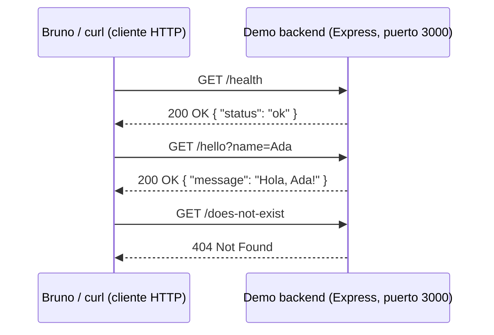

# Topic 02 — Ejecutar el proyecto y probar endpoints con Bruno

Este topic **no escribimos backend todavía**. Practicamos las dos
herramientas que vais a usar todas los topics del curso a partir de la
Topic 03: arrancar un proyecto Node.js desde la terminal y probar sus
endpoints HTTP con un cliente de API (Bruno) y con `curl`. Para ello
ejecutáis un demo pequeño **ya construido por el profesorado** — vosotros
no lo programáis, solo lo hacéis funcionar y lo probáis.

> **Idioma**: las explicaciones pedagógicas están en español. Los
> identificadores técnicos (`npm`, nombres de rutas, ficheros, comandos)
> van en inglés.

## Objetivos de aprendizaje

Al finalizar este topic serás capaz de:

- Ubicar un proyecto Node.js existente, leer su `package.json` y
  ejecutar sus scripts (`install`, `dev`, `build`) sin ayuda.
- Explicar la diferencia entre `.env.example` (se versiona) y `.env` (no
  se versiona) y copiar uno a partir del otro.
- Instalar la aplicación Bruno, abrir una colección existente y enviar
  peticiones `GET` contra un servidor local.
- Leer una respuesta HTTP identificando sus tres partes: código de
  estado, cabeceras y cuerpo.
- Escribir el comando `curl` equivalente a cualquier petición de Bruno.
- Diagnosticar, a partir únicamente de la salida de la terminal, tres
  causas frecuentes de que un servidor no arranque: falta de `.env`,
  falta de una dependencia y puerto ya ocupado.

## Prerrequisitos

- **De la Topic 01**: Node.js ≥ 20.19 (recomendado 22 LTS) y Git ≥ 2
  instalados y verificados; acceso al repositorio del curso (material y
  demo) y a tu propio repositorio de equipo;
  equipo de 3–4 personas formado con roles asignados.
- No se asume ningún conocimiento previo de TypeScript o Express: eso
  empieza en la [Topic 03](../topic-03-UT3-typescript-express-setup/).
  Este topic **ejecutáis** código ya escrito, no lo escribís.
- La aplicación de escritorio [Bruno](https://www.usebruno.com/downloads)
  instalada (gratuita, sin cuenta obligatoria para uso local).

## Conceptos del topic

- **`package.json` y sus scripts** — el manifiesto de cualquier proyecto
  Node.js. Su sección `"scripts"` define comandos con nombre que se
  ejecutan con `npm run <nombre>`. Es la primera parada al abrir un
  proyecto desconocido.
- **`.env` vs `.env.example`** — `.env.example` es una plantilla pública
  que se versiona en Git; `.env` contiene los valores reales de tu
  máquina y **nunca** se versiona (está en `.gitignore`). El demo de esta
  topic solo necesita una variable: `PORT`.
- **Cliente HTTP** — un programa que envía peticiones HTTP y muestra la
  respuesta. Bruno (interfaz gráfica) y `curl` (línea de comandos) son
  dos clientes HTTP distintos que pueden enviar **exactamente la misma**
  petición; el servidor no distingue cuál la originó.
- **Colección de Bruno** — un conjunto de peticiones HTTP guardadas como
  ficheros de texto plano `.bru`, organizadas en una carpeta, que se
  versionan en Git igual que el código. Este topic usáis una colección
  ya creada; en topics futuros crearéis las vuestras.
- **Anatomía de una respuesta HTTP** — código de estado (`200`, `404`...),
  cabeceras (metadatos como `Content-Type`) y cuerpo (los datos, aquí
  siempre JSON).
- **Fallo de arranque** — un proceso que termina inmediatamente al
  intentar iniciarse, casi siempre por una de tres causas: configuración
  ausente, dependencia ausente, o un recurso (como un puerto de red) ya
  ocupado por otro proceso.



Diagrama fuente: [`assets/http-request-flow.md`](./assets/http-request-flow.md).

## Ejemplo guiado

El profesor recorre en clase el demo backend de
[`code/backend/`](./code/backend/) y la colección de
[`code/bruno/`](./code/bruno/), en este orden:

1. **Explorar el proyecto sin ejecutarlo**: abre `package.json`,
   `.env.example` y `src/server.ts` en el editor. Señala la sección
   `"scripts"`, la única variable de entorno (`PORT`) y las dos rutas
   definidas (`app.get('/health', ...)`, `app.get('/hello', ...)`).
2. **Arrancarlo**:

   ```bash
   cd topics/topic-02-UT1-running-project-bruno-basics/code/backend
   cp .env.example .env
   npm install
   npm run dev
   ```

   Salida esperada (las últimas líneas):

   ```text
   > topic-02-demo-backend@1.0.0 dev
   > tsx watch src/server.ts

   Connectia Topic 02 demo backend listening on http://localhost:3000
   ```

3. **Probarlo con curl**, en otra terminal:

   ```bash
   curl -sS -i http://localhost:3000/health
   ```

   ```text
   HTTP/1.1 200 OK
   Content-Type: application/json; charset=utf-8

   {"status":"ok"}
   ```

4. **Abrir la colección de Bruno**: "Open Collection" → carpeta
   `code/bruno/` → entorno `local` → enviar `01-health`. El profesor
   compara la respuesta que muestra Bruno con la que acaba de mostrar
   `curl`: son la misma petición, dos herramientas distintas.
5. **Provocar el fallo de `.env` ausente** (demostración deliberada):
   `mv .env .env.bak && npm run dev` → el proceso termina con un mensaje
   claro. Se explica por qué, y se restaura `.env`.

Todo el código de ejemplo vive en [`./code/`](./code/); instrucciones
completas de ejecución en [`code/README.md`](./code/README.md).

## Actividades del alumnado

Las actividades viven en [`./exercises/`](./exercises/). Completa todas
en orden: cada una asume que la anterior está terminada y que el demo
backend sigue corriendo desde la Actividad 2.

| # | Actividad | Plantilla | Objetivo |
|---|-----------|-----------|----------|
| 1 | Clonar y explorar el proyecto | [`01-clone-and-explore-template.md`](./exercises/01-clone-and-explore-template.md) | Leer `package.json`, `.env.example` y `src/server.ts` antes de ejecutar nada. |
| 2 | Ejecutar los scripts de npm | [`02-npm-scripts-evidence-template.md`](./exercises/02-npm-scripts-evidence-template.md) | `npm install`, `npm run typecheck`, `npm run build`, `npm run dev` con salida capturada. |
| 3 | Instalar Bruno y abrir la colección | [`03-bruno-install-and-collection-template.md`](./exercises/03-bruno-install-and-collection-template.md) | Instalar la app, abrir `code/bruno/`, seleccionar el entorno `local`. |
| 4 | Enviar GET /health y leer la respuesta | [`04-get-request-health-evidence-template.md`](./exercises/04-get-request-health-evidence-template.md) | Identificar código de estado, cabeceras y cuerpo; escribir el curl equivalente. |
| 5 | Enviar GET /hello con parámetro | [`05-get-request-hello-evidence-template.md`](./exercises/05-get-request-hello-evidence-template.md) | Comparar la respuesta con y sin `name`; escribir los curl equivalentes. |
| 6 | De Bruno a curl (tabla completa) | [`06-curl-equivalents-template.md`](./exercises/06-curl-equivalents-template.md) | Consolidar el comando curl de las cuatro peticiones de la colección. |
| 7 | Diagnosticar un servidor que no arranca | [`07-diagnose-broken-server-template.md`](./exercises/07-diagnose-broken-server-template.md) | Reproducir y explicar: `.env` ausente, dependencia ausente, puerto ocupado. |

## Incremento topicl del proyecto

Este topic el "incremento" no es código de equipo (eso empieza en la
Topic 03): es **capacidad demostrada**. Al final de la Topic 02, cada
equipo tiene:

- Las siete plantillas de `exercises/` completadas en
  `team-docs/topic-02/`, con salida de terminal y capturas de Bruno
  reales (no inventadas).
- Evidencia de que el equipo completo sabe arrancar un proyecto Node.js
  ajeno sin ayuda del profesorado.
- Evidencia de que el equipo completo sabe usar Bruno y `curl` de forma
  intercambiable para probar un endpoint.

No se entrega backend propio del equipo: el `code/backend/` y el
`code/bruno/` de este topic son material de referencia compartido,
idéntico para todos los equipos.

## Criterios de aceptación

- [ ] `npm install`, `npm run typecheck`, `npm run build` y `npm run dev`
  ejecutados con éxito por cada miembro del equipo, con salida capturada.
- [ ] La colección de Bruno se abre sin errores y las cuatro peticiones
  (`01-health`, `02-hello-default`, `03-hello-with-name`,
  `04-not-found-demo`) se envían con éxito contra el demo backend en
  ejecución.
- [ ] Los cuatro códigos de estado observados son exactamente `200`,
  `200`, `200` y `404`, con los cuerpos JSON documentados.
- [ ] Existe un comando `curl` equivalente, correcto y probado, para cada
  una de las cuatro peticiones.
- [ ] Los tres escenarios de fallo de arranque (`.env` ausente,
  `node_modules/` ausente, puerto ocupado) están reproducidos con salida
  de terminal literal y explicados correctamente.
- [ ] El proyecto queda en estado funcional al finalizar el topic
  (`.env` presente, `node_modules/` presente, ningún proceso zombi
  ocupando el puerto `3000`).

## Errores comunes y depuración

- **Síntoma**: `npm run dev` termina con `Missing required environment
  variable: PORT.`
  **Causa habitual**: no se copió `.env.example` a `.env` (Actividad 7,
  Escenario A).
  **Cómo depurarlo**: `cp .env.example .env` dentro de `code/backend/` y
  volver a ejecutar `npm run dev`.

- **Síntoma**: `sh: tsx: command not found` (o un error de módulo no
  encontrado) al ejecutar `npm run dev`.
  **Causa habitual**: no se ejecutó `npm install`, o `node_modules/` fue
  borrado o movido (Actividad 7, Escenario B).
  **Cómo depurarlo**: ejecutar `npm install` dentro de `code/backend/` y
  reintentar.

- **Síntoma**: `npm run dev` termina con `Port 3000 is already in use.`
  **Causa habitual**: ya hay otra copia del demo (u otro proceso)
  escuchando en el puerto `3000` (Actividad 7, Escenario C).
  **Cómo depurarlo**: detener el proceso anterior (`Ctrl+C` en su
  terminal) o cambiar `PORT` en `.env` y volver a intentar.

- **Síntoma**: en Bruno, la petición se queda "cargando" indefinidamente
  o falla con un error de conexión.
  **Causa habitual**: el demo backend no está corriendo, o el entorno
  seleccionado en Bruno no es `local` (o su `baseUrl` no es
  `http://localhost:3000`).
  **Cómo depurarlo**: confirmar en la terminal que `npm run dev` sigue
  activo; revisar el selector de entorno en la esquina superior derecha
  de Bruno.

- **Síntoma**: `GET /hello` sin `name` devuelve `{"message":"Hola,
  mundo!"}` y el alumnado piensa que es un error.
  **Causa habitual**: expectativa de que faltar un parámetro debería dar
  un error `400`.
  **Cómo depurarlo**: recordar la regla de este topic — el demo usa un
  valor por defecto (`"mundo"`) en vez de fallar; la validación estricta
  de parámetros de entrada es un tema del Topic 07 (validación con zod),
  no de este topic.

## Mapeo DSW — RA1

> ⚠️ **Identificadores pendientes**: `references/dsw-learning-outcomes.md`
> está aún como PENDIENTE. Los identificadores de criterio siguen el
> patrón `RA1.CE-pending-N` hasta que se incorpore el texto oficial. Solo
> se actualizará el identificador y el texto abreviado; la actividad y la
> evidencia ya son válidas.

| RA | Criterio de evaluación | Evidencia este topic |
|----|------------------------|------------------------|
| RA1 | `RA1.CE-pending-1` — *pendiente texto oficial* | Cada equipo ejecuta `npm install`, `npm run build` y `npm run dev` con éxito sobre un proyecto Node.js + TypeScript + Express existente (Actividades 1–2). |
| RA1 | `RA1.CE-pending-2` — *pendiente texto oficial* | Cada equipo instala Bruno, abre una colección existente y envía las cuatro peticiones documentadas, leyendo correctamente estado, cabeceras y cuerpo (Actividades 3–5). |
| RA1 | `RA1.CE-pending-3` — *pendiente texto oficial* | Cada equipo escribe el comando `curl` equivalente y correcto para cada petición de la colección (Actividad 6). |
| RA1 | `RA1.CE-pending-4` — *pendiente texto oficial* | Cada equipo reproduce y explica correctamente tres causas frecuentes de fallo de arranque de un servidor (Actividad 7). |

Referencia normativa (pendiente):
[`references/dsw-learning-outcomes.md`](../../references/dsw-learning-outcomes.md).

## Autoevaluación

Responde a cada pregunta con **sí / con dudas / no**. Si respondes "con
dudas" o "no" a alguna, revisa la sección correspondiente antes de
continuar a la Topic 03.

- ¿Puedo abrir un proyecto Node.js desconocido y averiguar qué comandos
  ejecutar mirando solo su `package.json`?
- ¿Puedo explicar por qué `.env.example` se versiona en Git y `.env` no?
- ¿Puedo enviar una petición con Bruno y leer correctamente su código de
  estado, sus cabeceras y su cuerpo?
- ¿Puedo escribir de memoria el comando `curl` equivalente a una petición
  `GET` sencilla, con y sin parámetros de consulta?
- ¿Puedo diagnosticar, solo con la salida de la terminal, si un servidor
  no arranca por falta de `.env`, falta de dependencias o puerto
  ocupado?

## Notas de sesión para el profesorado

Guía operativa para impartir el topic. El material para el alumnado está
en las secciones anteriores; los apuntes pedagógicos de cada actividad
viven dentro de sus plantillas en [`exercises/`](./exercises/).

### Distribución de las 7 horas

| Bloque | Tiempo | Descripción |
|--------|--------|-------------|
| Instrucción directa | 1 h | `package.json` y sus scripts, `.env` vs `.env.example`, anatomía de una petición/respuesta HTTP, qué es un cliente HTTP (Bruno y curl como equivalentes). |
| Demostración guiada | 1 h | Recorrido en vivo del "Ejemplo guiado": explorar sin ejecutar → `npm install && npm run dev` → `curl` → Bruno → provocar el fallo de `.env` ausente. |
| Práctica supervisada | 2 h | Cada estudiante instala Bruno y completa las Actividades 1–5 (clonar, npm scripts, abrir colección, `GET /health`, `GET /hello`). |
| Trabajo de proyecto | 2 h | Cada equipo completa las Actividades 6 y 7 (tabla de curl equivalentes; los tres escenarios de fallo de arranque), documentando salida real. |
| Revisión | 0,5 h | Revisión cruzada entre equipos: cada equipo verifica los tres escenarios de fallo documentados por otro equipo, comparando la salida de su propio sistema operativo. |
| Evaluación | 0,5 h | Comprobación oral rápida por equipo (ver "Puntos de control") + recogida de evidencias. |

**Total: 7 horas.**

### Preparación previa

- [ ] Node.js 22 LTS y npm ≥ 10 verificados en el equipo de demostración
  del profesorado.
- [ ] La aplicación Bruno instalada y probada en el equipo de
  demostración; versión anotada por si el alumnado pregunta cuál
  descargar.
- [ ] `code/backend/` clonado limpio, `npm install` ejecutado con
  antelación una vez para confirmar que no hay sorpresas de red o de
  proxy del centro.
- [ ] `code/bruno/` abierto una vez en Bruno antes de clase para
  confirmar que el entorno `local` funciona sin ajustes.
- [ ] Comando de reserva preparado: `npx @usebruno/cli run --env local`
  desde `code/bruno/` con el demo backend corriendo, por si la app de
  escritorio de Bruno falla en el proyector.
- [ ] Al menos **dos equipos de aula** con Node.js 22 LTS preinstalado
  como reserva, igual que en la Topic 01.
- [ ] Copia impresa (o digital compartida) de las siete plantillas de
  `exercises/`.

### Guión de demostración

1. **Explorar sin ejecutar** (~10 min). Abre `package.json`,
   `.env.example` y `src/server.ts` en el proyector. Pregunta al aula:
   "¿qué comandos creéis que existen, solo mirando `scripts`?" antes de
   revelar la respuesta.
2. **Arrancar el demo** (~10 min). `cp .env.example .env`, `npm install`,
   `npm run dev`. Señala explícitamente la línea "listening on
   http://localhost:3000": es la confirmación de que el servidor está
   vivo.
3. **Probar con curl** (~10 min). `curl -sS -i http://localhost:3000/health`
   en vivo. Señala las tres partes de la respuesta línea por línea.
4. **Probar con Bruno** (~15 min). Abre la colección, envía `01-health`,
   compara visualmente con la salida de `curl` del paso anterior — deben
   coincidir en estado y cuerpo. Envía `03-hello-with-name` y cambia el
   valor de `name` en directo.
5. **Provocar un fallo a propósito** (~15 min). `mv .env .env.bak && npm
   run dev` → mostrar el mensaje de error → explicar por qué ocurre →
   `mv .env.bak .env` → volver a arrancar con éxito. Repetir brevemente
   con el escenario de puerto ocupado (dos terminales).
6. **Introducción a las actividades** (~5 min). Recorrer la tabla de
   "Actividades del alumnado" y señalar que la Actividad 7 reutiliza
   exactamente los fallos que se acaban de demostrar.

**Plan de recuperación si algo falla en vivo**: si el proyector o la red
del centro fallan, usar capturas de pantalla pre-preparadas de cada paso
(guardadas de un ensayo previo) y narrar los comandos aunque no se
ejecuten en directo. El comando de reserva `npx @usebruno/cli run --env
local` sustituye a la demostración de la app de escritorio si esta
falla.

### Conceptos erróneos esperados

- **"Bruno y curl son cosas distintas, hay que aprenderse las dos por
  separado"** — Respuesta: son dos formas de enviar la **misma**
  petición HTTP. Si sabes construirla en una, sabes construirla en la
  otra; la Actividad 6 lo demuestra explícitamente.
- **"`GET /hello` sin `name` debería devolver un error"** — Respuesta:
  no este topic. El demo usa un valor por defecto a propósito; la
  validación estricta de parámetros llega en el Topic 07.
- **"Si el servidor no arranca, algo está roto de verdad y hay que
  avisar al profesor"** — Respuesta: en el 90 % de los casos es una de
  las tres causas de la Actividad 7 (falta `.env`, falta
  `node_modules/`, puerto ocupado) y se diagnostica solo, leyendo el
  mensaje de la terminal.
- **"`npm run dev` y `npm start` son lo mismo"** — Respuesta: no. `dev`
  ejecuta el código fuente directamente con recarga automática; `start`
  ejecuta el JavaScript ya compilado en `dist/` (tema que se profundiza
  en la Topic 03).

### Puntos de control

- **Check 1 — tras la demostración guiada** (final de la 2ª hora): pide a
  3 estudiantes al azar que expliquen, en una frase cada uno, qué
  diferencia hay entre `.env` y `.env.example`.
  - Si ≥ 80 % responde correctamente → continuar.
  - Si < 80 % → repetir la explicación con el fichero abierto en el
    proyector, señalando ambos lado a lado.

- **Check 2 — a mitad de la práctica supervisada** (~4ª hora): verificar
  que cada equipo tiene el demo backend corriendo y ha enviado al menos
  la petición `01-health` desde Bruno con éxito.
  - Si algún equipo no lo ha logrado → intervención directa; revisar en
    su pantalla si `.env` existe y si `npm install` terminó con éxito.

### Diferenciación

- **Apoyo** para estudiantes con dificultades:
  - Emparejar con un compañero o compañera que ya tenga el demo
    corriendo, para observar el flujo completo una vez antes de
    repetirlo solos.
  - Proporcionar la salida esperada de cada comando en papel (o en un
    documento compartido) para comparar línea a línea.
  - Priorizar las Actividades 1–5 y dejar la Actividad 7 (diagnóstico)
    para una sesión de refuerzo si el tiempo aprieta.

- **Extensión** para estudiantes que terminan pronto:
  - Añadir una quinta petición propia a la colección de Bruno (por
    ejemplo, `GET /hello?name=` con un valor con espacios o caracteres
    especiales) y documentar el resultado.
  - Investigar y anotar qué cabecera HTTP indica el tamaño del cuerpo de
    la respuesta (`Content-Length`) y verificar que coincide con el
    número real de caracteres del JSON devuelto.
  - Leer por encima `code/backend/src/server.ts` completo y anotar, sin
    que se les pida todavía, qué parte creen que cambiará en el Topic
    03 (pista: el fichero se dividirá en varios).

### Evidencias de evaluación (recogida por equipo)

- [ ] Plantillas 1–2 completas con salida literal de `npm install`,
  `npm run typecheck`, `npm run build` y `npm run dev`. → Evidencia para
  `RA1.CE-pending-1`.
- [ ] Plantillas 3–5 completas con capturas/descripciones de Bruno
  mostrando los cuatro códigos de estado y cuerpos esperados. → Evidencia
  para `RA1.CE-pending-2`.
- [ ] Plantilla 6 completa con la tabla de cuatro comandos `curl` y su
  salida ejecutada. → Evidencia para `RA1.CE-pending-3`.
- [ ] Plantilla 7 completa con los tres escenarios de fallo reproducidos,
  salida literal y explicación correcta de cada uno. → Evidencia para
  `RA1.CE-pending-4`.

Consultar
[`syllabus/README.md`](./syllabus/README.md)
para la lista de items que el alumnado debe conocer al superar este topic.
