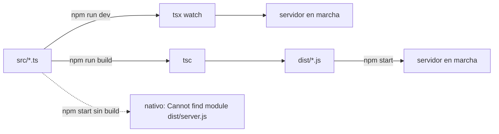

# Topic 03 — Configuración de TypeScript y Express

En el Topic 02 ejecutasteis un proyecto ajeno: leísteis su `package.json`,
ejecutasteis sus scripts y copiasteis su `.env.example`. Este topic da el
salto de **consumir** un proyecto a **escribirlo**: un backend mínimo en
**Node.js + TypeScript + Express** con TypeScript estricto, scripts de
desarrollo y de build, carga de variables de entorno con Node nativo,
linter, formateador, separación entre aplicación y arranque de red, y un
endpoint `GET /health/live`.

El proyecto **no se entrega de golpe**: cada actividad añade solo los
ficheros que explica. Al final del topic tenéis exactamente el mismo
proyecto de referencia, pero construido pieza a pieza.

> **Idioma**: las explicaciones pedagógicas están en español. Los
> identificadores técnicos (`node`, `git`, `PORT`, `NODE_ENV`, `dist`, etc.)
> van en inglés.

## Objetivos de aprendizaje

Al finalizar este topic serás capaz de:

- Inicializar un proyecto Node.js con `package.json` y saber para qué sirve
  cada script.
- Explicar qué es un **formateador** (Prettier), qué es un **linter**
  (ESLint) y por qué no son la misma herramienta.
- Configurar TypeScript en modo `strict` y justificar cada opción del
  `tsconfig.json`.
- Explicar la diferencia entre `Promise`, `async/await`, funciones tipadas
  e interfaces en TypeScript.
- Cargar variables de entorno desde `.env` **de forma nativa**
  (`process.loadEnvFile()`) y leerlas con valores por defecto.
- Distinguir entre crear la aplicación Express (`app.ts`) y arrancar el
  servidor de red (`server.ts`).
- Explicar qué contienen los objetos `req` y `res` que Express pasa a
  cada handler de ruta, y usarlos para leer la petición y construir la
  respuesta.
- Ejecutar el ciclo completo: `npm install → npm run typecheck →
  npm run build → npm run dev` y comprobar el resultado con `curl`.
- Construir un proyecto de forma incremental: cada fichero aparece en la
  actividad donde se explica.

## Prerrequisitos

**Qué asumimos del Topic 02**:

- Cada estudiante tiene Node.js **≥ 20.19** (LTS 20 actualizado, o 22.9+;
  comprobado con `node --version`) y Git ≥ 2 instalados.
- Cada equipo ha *ejecutado* un proyecto Node.js: sabe leer un
  `package.json`, ejecutar `npm install` / `npm run dev` y copiar
  `.env.example` a `.env`. Este topic lo escribe desde cero.
- Cada equipo tiene su propio repositorio y el flujo de PR hacia `main`
  en marcha.

**Ruta del backend**: el backend del equipo vive en la **raíz** de su
repositorio, como un proyecto Node.js normal (sin carpeta `apps/`). Los
documentos del equipo —backlog, ejercicios, evidencias— van en la carpeta
`team-docs/` del mismo repositorio.

## Conceptos del topic

- **`package.json`** — el manifiesto del proyecto Node.js: dependencias,
  versión mínima de Node, `type: "module"` (ESM), y `scripts`.
- **npm scripts** — comandos con nombre (`dev`, `build`, `start`,
  `typecheck`, `lint`, `format`) que se ejecutan con `npm run <script>`.
- **ES Modules (ESM)** — `import` y `export` en lugar de `require`/`module.exports`.
  Los ficheros `.ts` importan compañeros con la extensión `.js`
  (`import { foo } from './foo.js'`), aunque el fichero real sea `.ts`.
- **TypeScript en modo `strict`** — activa las comprobaciones estrictas
  (nulos, cualquier `any` implícito prohibido, etc.); el bug se detecta al
  compilar en vez de en producción.
- **Interfaces y funciones tipadas** — la forma en que declaramos el
  contrato de datos y de funciones.
- **`Promise` / `async` / `await`** — cómo trabajamos con operaciones
  asíncronas (I/O, red, disco) sin bloquear el proceso.
- **App vs. Server** — `app.ts` construye la aplicación Express (un
  valor); `server.ts` la importa y llama a `.listen()` para abrir un
  puerto. Importar `app.ts` **no** abre ningún puerto.
- **`req` y `res`** — los dos objetos que Express crea por cada petición
  y pasa al handler de la ruta: `req` (Request) es la **petición
  entrante** ya parseada (método, URL, cabeceras, query, body) y `res`
  (Response) es la **respuesta que construís** (`res.status()`,
  `res.json()`). Se exploran en la Actividad 8.
- **Variables de entorno y `.env`** — configuración que llega al proceso
  desde fuera: puerto, URLs, secretos. Viven en `process.env`. El fichero
  `.env` (no versionado) las guarda; Node lo carga **sin librerías** con
  `process.loadEnvFile()` (Node ≥ 20.12). `.env.example` es la plantilla
  pública que sí se versiona. Las variables del entorno real tienen
  prioridad sobre las del fichero.
- **ESLint** — un **linter**: analiza el código en busca de errores
  probables (variables sin usar, código inalcanzable...) y los reporta con
  el nombre de la regla violada.
- **Prettier** — un **formateador**: reescribe el código para que todo el
  equipo comparta exactamente el mismo estilo. No busca bugs, solo formato.

> **Nota**: la validación del *contenido* de las variables de entorno
> (fail-fast con esquemas) se introduce en el Topic 07, cuando el proyecto
> ya necesita validar también los cuerpos de las peticiones. Aquí solo
> cargamos y leemos la configuración, con valores por defecto.

## Ejemplo guiado

El profesor reproduce, paso a paso, el proyecto de referencia que vive en
[`code/backend/`](./code/backend/). El diagrama
[`assets/build-vs-dev-flow.md`](./assets/build-vs-dev-flow.md) muestra
las dos rutas que aprenderemos a distinguir:



**Ruta de desarrollo (`npm run dev`)**: `tsx` ejecuta directamente los
ficheros `.ts` con recarga en caliente. No se produce `dist/`.

**Ruta de build (`npm run build && npm start`)**: `tsc` compila `src/` a
`dist/` y `npm start` ejecuta el JavaScript compilado (`node
dist/server.js`) con Node. **`npm start` nunca compila**: si aún no has
hecho `npm run build`, `dist/` no existe y Node falla con su error nativo
`Cannot find module '.../dist/server.js'`. Ese error es la señal de que
falta el build — construye primero.

Estructura de ficheros del proyecto **al final del topic** (cada actividad
añade los suyos):

```
code/backend/
├── package.json        # A1: manifiesto y script dev; A3, A5 y A6 añaden scripts
├── tsconfig.json       # A3: configuración estricta de TypeScript
├── eslint.config.js    # A5: flat config de ESLint
├── .prettierrc.json    # A6: configuración de Prettier
├── .prettierignore     # A6: rutas que Prettier debe ignorar
├── .gitignore          # A2: rutas que Git debe ignorar
├── .env.example        # A2: plantilla pública de variables de entorno
└── src/
    ├── app.ts          # A7: createApp() → devuelve la aplicación Express
    ├── server.ts       # A1: servidor único con puerto fijo; A2 lo lee del .env; A4 usa config/env; A7 queda mínimo
    ├── config/
    │   └── env.ts      # A4: carga .env (loadEnvFile) y exporta PORT/NODE_ENV
    └── routes/
        └── health.ts   # A7: GET /health/live → { status: "live" }
```

La Actividad 8 **no añade ficheros**: es un laboratorio temporal sobre el
proyecto ya terminado (se explora `req` y `res` y todo se revierte al
final), así que el proyecto de referencia no cambia.

Consulta [`code/README.md`](./code/README.md) para las instrucciones
concretas de instalación y ejecución del proyecto de referencia.

## Actividades del alumnado

### Actividad 1 — `package.json` y el primer servidor

**Objetivo**: crear el manifiesto `package.json` (con `"type": "module"`,
`engines` y el script `dev`) y aprender a instalar dependencias: una de
producción (`express`, con `npm install`) y una de desarrollo (`tsx`, con
`npm install -D`), viendo cómo npm las anota solas en `dependencies` y
`devDependencies`. Escribir el primer `src/server.ts` con la ruta
`/health/live` y el puerto **escrito en el código**, arrancarlo con
`npm run dev` y comprobarlo con `curl`.

**Entregable**: fichero `01-bootstrap-checklist.md` siguiendo la plantilla
[`exercises/01-bootstrap-checklist.md`](./exercises/01-bootstrap-checklist.md).

**Criterio de aceptación**: el `package.json` contiene los campos, el script
`dev`, `dependencies` con `express` y `devDependencies` con `tsx`; existe
`src/server.ts`; `npm run dev` arranca y `curl -sS -i /health/live` responde
`200` con `{"status":"live"}`; el equipo explica la diferencia entre
`dependencies` y `devDependencies`.

### Actividad 2 — `.gitignore` y variables de entorno

**Objetivo**: resolver los dos problemas que deja la Actividad 1. Añadir el
`.gitignore` (que ignora `node_modules/`, `dist/` y `.env`), la plantilla
pública `.env.example` y tu `.env` local (no versionado); y **modificar
`src/server.ts`** para que el puerto deje de estar escrito en el código y se
lea del `.env` con `process.loadEnvFile()` y `??`.

**Entregable**: `02-env-gitignore-evidence.md` siguiendo
[`exercises/02-env-gitignore-evidence.md`](./exercises/02-env-gitignore-evidence.md).

**Criterio de aceptación**: `curl -sS -i /health/live` sigue respondiendo
`200` con `{"status":"live"}`; cambiando **solo** el `.env` a `PORT=4000` el
servidor arranca en el 4000 sin tocar el código; `git status` muestra
`.gitignore` y `.env.example` pero **no** `.env` ni `node_modules/`.

### Actividad 3 — TypeScript estricto y el ciclo build/start

**Objetivo**: añadir `tsconfig.json` con `"strict": true` y los scripts
`typecheck`, `build` y `start`; comprobar que un error de tipo intencionado
**rompe** el build y que `npm start` **exige un build previo**: sin
`dist/`, Node falla con su error nativo `Cannot find module
'.../dist/server.js'`. `start` no compila — construir primero es tu trabajo.

**Entregable**: `03-tsconfig-strict-evidence.md` siguiendo
[`exercises/03-tsconfig-strict-evidence.md`](./exercises/03-tsconfig-strict-evidence.md).

**Criterio de aceptación**: `npm run build` pasa en limpio y genera
`dist/server.js`; tras introducir `const x: number = "oops"`, el build
falla con un diagnóstico TypeScript; sin `dist/`, `npm start` sale con el
error nativo de Node `Cannot find module '.../dist/server.js'`.

### Actividad 4 — Config centralizada (`src/config/env.ts`)

**Objetivo**: **un refactor**, sin funcionalidad nueva — mover la carga y la
lectura del `.env` (que la Actividad 2 dejó sueltas en `server.ts`) a un
único módulo, `src/config/env.ts`, que exporta un objeto `env` con `PORT` y
`NODE_ENV`. Entender por qué el orden de evaluación de los `import` hace que
el `.env` siempre esté cargado antes de leerse, y comprobar que el entorno
real tiene prioridad sobre el fichero.

**Entregable**: `04-env-config-refactor.md` siguiendo
[`exercises/04-env-config-refactor.md`](./exercises/04-env-config-refactor.md).

**Criterio de aceptación**: `server.ts` importa `env` de `config/env.js` y
**ya no menciona `process.env`**; `curl /health/live` responde igual que
antes del refactor; `PORT=4321 npm run dev` arranca en el 4321 aunque `.env`
diga 3000; sin `.env`, el proceso muere en menos de 2 segundos con `ENOENT`;
la línea de arranque imprime el `NODE_ENV` recibido.

### Actividad 5 — ESLint, el linter

**Objetivo**: instalar y configurar **solo el linter**: las
`devDependencies` de ESLint, la flat config `eslint.config.js` y el script
`lint`. Ejecutarlo en limpio, provocar una violación intencionada y
comprobar que el compilador **no** la detecta (son dos redes distintas).

**Entregable**: `05-linter.md` siguiendo
[`exercises/05-linter.md`](./exercises/05-linter.md).

**Criterio de aceptación**: `npm run lint` sale con código 0 en limpio;
tras añadir una variable no usada, falla y **nombra** la regla violada
(`@typescript-eslint/no-unused-vars`) mientras `npm run typecheck` sigue
pasando; el equipo puede explicar qué es un linter y justificar al menos
una regla activa.

### Actividad 6 — Prettier, el formateador

**Objetivo**: añadir el formateador (`prettier` como `devDependency`,
`.prettierrc.json`, `.prettierignore` y los scripts `format` y
`format:check`), entender la diferencia entre `--write` y `--check`, y
cerrar el concepto que el topic evalúa: **linter ≠ formateador**.

**Entregable**: `06-formatter.md` siguiendo
[`exercises/06-formatter.md`](./exercises/06-formatter.md).

**Criterio de aceptación**: `npm run format:check` sale con código 0 en
limpio; tras meter una línea mal formateada, falla y **lista el fichero**,
y `npm run format` la arregla; el equipo puede explicar qué hace un
formateador, por qué `trailingComma` reduce el ruido de los diffs y por
qué no es el mismo trabajo que el del linter.

### Actividad 7 — Separación App vs. Server (refactor)

**Objetivo**: refactorizar el `server.ts` único en tres ficheros:
`src/app.ts` exporta `createApp()` (sin `.listen()`), `src/routes/health.ts`
guarda el router y `src/server.ts` solo importa y escucha.

**Entregable**: `07-app-server-split-evidence.md` siguiendo
[`exercises/07-app-server-split-evidence.md`](./exercises/07-app-server-split-evidence.md).

**Criterio de aceptación**: importar `app.ts` no abre ningún puerto;
`curl -sS -i http://localhost:3000/health/live` devuelve HTTP 200 con el
cuerpo exacto `{"status":"live"}`; el equipo explica por qué existe la
separación referenciando la testabilidad futura.

### Actividad 8 — Primer contacto con `req` y `res`

**Objetivo**: explorar, en un laboratorio temporal que se revierte al
final, los dos objetos que Express pasa a cada handler: `req` (la
petición entrante) y `res` (la respuesta que se construye). Incluye el
primer log del servidor (`req.method`, `req.originalUrl`), una ruta
`GET /echo` que responde con lo que llega y la prueba de un código de
estado distinto (`201`).

**Entregable**: `08-req-res-first-contact.md` siguiendo
[`exercises/08-req-res-first-contact.md`](./exercises/08-req-res-first-contact.md).

**Criterio de aceptación**: las capturas del laboratorio están en la
plantilla (log del servidor, respuesta de `GET /echo` con query params,
`curl -i` con `201` antes de revertir, `curl -i` final con `200`
exacto); el proyecto revertido pasa `npm run typecheck` y responde
`/health/live` exactamente como el contrato; el equipo sabe explicar en
una línea qué son `req` y `res`, quién los crea y por qué
`console.log(req)` no es una forma aceptable de inspeccionar una
petición.

## Incremento del topic en el proyecto

Al final del topic cada equipo tiene:

- Proyecto backend mínimo en la **raíz** del repositorio del equipo.
- `npm run dev` arranca el servidor en `PORT` y responde `200` a
  `GET /health/live` con el cuerpo `{"status":"live"}`.
- `npm run build` compila `src/` a `dist/` sin errores; un error de tipo
  intencionado lo rompe.
- `npm start` ejecuta el JavaScript compilado (`dist/server.js`); si
  `dist/` no existe, falla con el error nativo de Node — el build es
  siempre el paso previo.
- `src/config/env.ts` centraliza la carga del `.env` con valores por
  defecto (la validación con zod llega en el Topic 07).
- ESLint y Prettier funcionan; los checks pasan en limpio.
- Ocho entregas Markdown con la evidencia de cada actividad.

## Criterios de aceptación

- [ ] El proyecto backend existe en la raíz del repositorio del equipo con
  los ficheros del proyecto de referencia.
- [ ] `npm install` en esa ruta termina con código 0.
- [ ] `.env.example` está versionado y `.env` no (`.gitignore` lo ignora).
- [ ] `npm run typecheck` termina con código 0.
- [ ] `npm run build` termina con código 0 y genera `dist/server.js`.
- [ ] `npm run dev` arranca el servidor y `curl -sS -i /health/live`
  devuelve HTTP 200 con el cuerpo exacto `{"status":"live"}`.
- [ ] Un error de tipo intencionado rompe `npm run build` con código ≠ 0.
- [ ] Sin `.env`, `npm run dev` sale con código ≠ 0 en < 2 s (error nativo
  `ENOENT` de `process.loadEnvFile()`).
- [ ] `PORT=4321 npm run dev` arranca en el 4321 aunque `.env` diga otra
  cosa (el entorno real manda sobre el fichero).
- [ ] Sin `dist/`, `npm start` falla con el error nativo de Node
  `Cannot find module '.../dist/server.js'` (y tras `npm run build`
  arranca el servidor compilado).
- [ ] `npm run lint` y `npm run format:check` pasan en limpio.
- [ ] Una variable no usada intencionada rompe `npm run lint`.
- [ ] Actividad 8: las evidencias del laboratorio `req`/`res` están
  capturadas en `team-docs/topic-03/08-req-res-first-contact.md` y el
  proyecto revertido responde `curl -sS -i /health/live` con `200` y el
  cuerpo exacto `{"status":"live"}`.

## Errores comunes y depuración

- **Síntoma**: `SyntaxError: Unexpected token 'export'` al ejecutar
  `node src/app.ts`.
  **Causa habitual**: intentar ejecutar TypeScript directamente con `node`.
  **Cómo depurarlo**: usar `npm run dev` (que llama a `tsx`) o
  `npm run build && npm start` (que ejecuta el JavaScript compilado).

- **Síntoma**: `Error: Cannot find module '.../dist/server.js'` al
  ejecutar `npm start`.
  **Causa habitual**: no existe `dist/` porque aún no has compilado.
  `npm start` **no compila**: solo ejecuta el JavaScript que el build ya
  produjo. **Cómo depurarlo**: ejecuta `npm run build` y después
  `npm start`. Recuerda la regla del topic: **primero `build`, luego
  `start`**.

- **Síntoma**: `ERR_MODULE_NOT_FOUND` al importar un fichero propio.
  **Causa habitual**: falta la extensión `.js` en el `import`.
  **Cómo depurarlo**: en ESM con `moduleResolution: NodeNext`, los imports
  relativos requieren la extensión: `import { createApp } from './app.js'`
  (aunque el fichero real sea `app.ts`).

- **Síntoma**: `Error: listen EADDRINUSE :3000`.
  **Causa habitual**: hay otro `npm run dev` corriendo o algún otro
  proceso ocupa el puerto.
  **Cómo depurarlo**: en macOS/Linux, `lsof -i :3000` (o `lsof -ti :3000
  | xargs kill`). En Windows PowerShell,
  `Get-NetTCPConnection -LocalPort 3000`.

- **Síntoma**: `Error: ENOENT: no such file or directory, open '.env'` al
  arrancar.
  **Causa habitual**: falta el fichero `.env`: `process.loadEnvFile()`
  falla si no existe (esto es deliberado — fail-fast sin librerías).
  **Cómo depurarlo**: `cp .env.example .env` en la raíz del backend.
  Comprobar también que `src/config/env.js` se importa antes de
  `createApp()` en `server.ts`: los `import` se evalúan primero, y ahí es
  donde el `.env` se carga.

- **Síntoma**: el puerto no cambia aunque edite `.env`.
  **Causa habitual**: la variable ya existe en el entorno real
  (`export PORT=...`): el entorno manda sobre el fichero.
  **Cómo depurarlo**: revisar `echo $PORT` en la terminal y reiniciarla.

- **Síntoma**: `console.log(req)` imprime una salida gigante llena de
  `[Circular *1]` (y cabeceras con secretos dentro).
  **Causa habitual**: se intenta loguear el objeto `req` entero: es
  enorme, tiene referencias circulares y en `req.headers` viajan datos
  sensibles.
  **Cómo depurarlo**: loguear campos concretos (`req.method`,
  `req.originalUrl`...). El logging estructurado llega en el Topic 05.

- **Síntoma**: `req.path` muestra `/live` en vez de `/health/live`
  dentro del router.
  **Causa habitual**: dentro de un router montado con prefijo, `req.path`
  solo contiene la parte del path que le toca al router.
  **Cómo depurarlo**: para la URL completa que llegó al servidor, usar
  `req.originalUrl`.

- **Síntoma**: `tsconfig.json` tiene `"strict": false` "porque compilaba
  antes".
  **Causa habitual**: el Topic 03 exige `strict: true`; alguien lo
  desactivó para saltarse un error.
  **Cómo depurarlo**: reactivar `strict: true` y **arreglar** los tipos.
  Desactivarlo esconde bugs en producción.

## Resultados de aprendizaje DSW

> ⚠️ **Identificadores pendientes**: `references/dsw-learning-outcomes.md`
> está aún como PENDIENTE. Los identificadores de criterio siguen el patrón
> `RAX.CE-pending-N` hasta que se incorpore el texto oficial. Solo se
> actualizará el identificador y el texto abreviado; la actividad y la
> evidencia ya son válidas.

| RA | Criterio de evaluación | Evidencia este topic |
|----|------------------------|------------------------|
| RA1 | `RA1.CE-pending-1` — *pendiente texto oficial* | Backend mínimo desplegado en la carpeta del equipo con `npm install` exitoso (Actividades 1-2). |
| RA1 | `RA1.CE-pending-2` — *pendiente texto oficial* | Estructura de proyecto Node.js + TypeScript documentada y ejecutable con comandos publicados. |
| RA5 | `RA5.CE-pending-1` — *pendiente texto oficial* | `tsconfig.json` con `strict: true` y evidencia de captura de error de tipo por el compilador (Actividad 3). |
| RA5 | `RA5.CE-pending-2` — *pendiente texto oficial* | Configuración de linter (Actividad 5) y de formateador (Actividad 6) en verde. |
| RA5 | `RA5.CE-pending-3` — *pendiente texto oficial* | Separación `app.ts` / `server.ts` demostrada con `curl /health/live` en verde (Actividad 7). |

Nota: la evidencia de **validación fail-fast de variables de entorno** se
recoge a partir del Topic 07, cuando se introduce `zod`.

Referencia normativa (pendiente):
[`references/dsw-learning-outcomes.md`](../../references/dsw-learning-outcomes.md).

## Autoevaluación

Responde a cada pregunta con **sí / con dudas / no**. Si respondes "con
dudas" o "no" a alguna, revisa la sección o el fichero correspondiente
antes de continuar al Topic 04.

- ¿Puedo explicar la diferencia entre `dev`, `build` y `start` en
  `package.json`?
- ¿Puedo justificar por qué usamos `type: "module"` (ESM) desde el inicio?
- ¿Puedo nombrar y justificar tres opciones de `tsconfig.json` que hayamos
  activado?
- ¿Puedo explicar por qué `strict: true` **no** debe desactivarse en topics
  futuros?
- ¿Puedo explicar qué hace `process.loadEnvFile()` y qué pasa si falta el
  `.env`?
- ¿Puedo explicar qué es un linter, qué es un formateador y por qué no son
  la misma herramienta?
- ¿Puedo explicar por qué `app.ts` no llama a `.listen()`?
- ¿Puedo explicar qué contienen `req` y `res`, y quién los crea y se los
  pasa a mi handler?
- ¿Puedo explicar por qué `console.log(req)` no es la forma de
  inspeccionar una petición?
- ¿Puedo ejecutar `npm run dev` en mi equipo y explicar cada línea de
  salida?
- ¿Puedo justificar por qué `npm start` **no** compila automáticamente?

## Notas de sesión para el profesorado

Guía operativa para impartir el Topic 03: distribución del tiempo,
preparación previa, guion de la demostración y evidencias de evaluación.
El material destinado al alumnado está en las secciones anteriores de este
fichero y en las plantillas de [`exercises/`](./exercises/).

### Distribución de las 7 horas

| Bloque | Tiempo | Descripción |
|--------|--------|-------------|
| Instrucción directa | 1 h | Qué es un `package.json`, un linter, un formateador y una variable de entorno; Node.js/npm; ESM vs. CommonJS; TypeScript compilador vs. runtime. |
| Demostración guiada | 1,5 h | Construcción en vivo del proyecto de referencia en el orden de las actividades: package.json y dependencias → .gitignore/.env → tsconfig y ciclo build/start → config/env → linter → formateador → separación app/server. |
| Práctica supervisada | 2 h | Cada equipo reproduce el proyecto en la raíz de su repositorio con guía activa, actividad a actividad. |
| Actividad 8: laboratorio `req`/`res` | 0,5 h | Cada equipo explora `req` y `res` con su plantilla (log del servidor, `/echo`, `201`) y captura las evidencias. |
| Trabajo de proyecto | 1 h | Cada equipo completa las 7 primeras actividades y rellena las plantillas de `exercises/`. |
| Revisión | 0,5 h | Revisión cruzada de PRs entre equipos: al menos un comentario sustantivo por PR. |
| Evaluación | 0,5 h | Comprobación con la checklist manual y recogida de evidencias por equipo. |

**Total: 7 horas.**

### Preparación previa

- [ ] En la máquina de demostración: Node.js ≥ 20.19 y npm ≥ 10 instalados
  (`node --version` = `v20.19+`, `npm --version` = `10.x`).
- [ ] El proyecto de referencia [`code/backend/`](./code/backend/) ejecutado
  al menos una vez antes de clase:
  `cd code/backend && npm install && npm run build && npm run dev` y
  `curl -sS http://localhost:3000/health/live` respondiendo
  `{"status":"live"}`.
- [ ] Un `.env` renombrado (`.env.bak`) preparado para la demo del error
  `ENOENT` sin editar en directo.
- [ ] Repositorio de cada equipo visible para el profesorado y con `main`
  al día.
- [ ] Carpeta `team-docs/` existente en el repositorio de cada equipo
  (aún vacía; se rellena en la práctica supervisada).
- [ ] Plantillas de las 8 actividades disponibles (link o copia impresa
  desde `exercises/`).

### Guión de demostración

1. **Conceptos antes de código** (~10 min). Cuatro definiciones en
   pizarra: qué es un **manifiesto** (`package.json`), qué es un
   **linter**, qué es un **formateador** y qué es una **variable de
   entorno**. Conectar con el Topic 02: ya ejecutasteis las tres primeras
   cosas sin escribirlas.

2. **A1 en vivo: `package.json` y dependencias** (~20 min). Crear el
   `package.json` (con `"type": "module"`, `engines` y el script `dev`) e
   instalar una dependencia de producción (`npm install express`) y una de
   desarrollo (`npm install -D tsx`), mostrando en directo cómo npm las
   anota solas en `dependencies` y `devDependencies`. Escribir **un único**
   `src/server.ts` con el puerto **fijo en el código** (`const PORT = 3000`)
   y la ruta `/health/live`. `npm run dev` + `curl`: el servidor responde ya
   en esta actividad. Cerrar mostrando `git status --short` con el ruido de
   `node_modules/` y nombrando los dos problemas pendientes (Git versiona
   lo que no debe; el puerto vive en el código).

3. **A2 en vivo: `.gitignore` y variables de entorno** (~15 min). Crear
   `.gitignore` (ignora `node_modules/`, `dist/` y `.env`), `.env.example`
   y copiarlo a `.env`; mostrar que el `git status` queda limpio. Modificar
   `src/server.ts`: `process.loadEnvFile()` y `Number(process.env.PORT ??
   3000)` en lugar del puerto fijo. Demo clave: cambiar **solo** el `.env`
   a `PORT=4000` y ver el servidor arrancar en el 4000 sin tocar código.
   Demo fail-fast: renombrar `.env` → `ENOENT`.

4. **A3 en vivo: TypeScript y el ciclo build/start** (~20 min). Escribir
   `tsconfig.json` justificando cada opción; añadir `typecheck`, `build` y
   `start` (que ejecuta `node dist/server.js`). Demo: error de tipo rompe
   el build; sin `dist/`, `npm start` muestra el error nativo de Node
   `Cannot find module` — mensaje para interiorizar: **primero build,
   luego start**.

5. **A4 en vivo: config centralizada** (~15 min). Plantearlo como refactor:
   escribir en pizarra cómo quedaría el proyecto con `process.env` repartido
   por tres ficheros (defaults duplicados, nadie sabe qué variables hay).
   Extraer entonces `src/config/env.ts` (carga + defaults + `export const
   env`); `server.ts` importa `env` y deja de mencionar `process.env`.
   Dibujar el orden de evaluación: los `import` de `server.ts` se evalúan
   antes de su cuerpo, así que `loadEnvFile()` corre primero. Demos:
   `PORT=4321 npm run dev` arranca en 4321 aunque `.env` diga 3000 (el
   entorno real manda); `PORT=abc` muere con `ERR_SOCKET_BAD_PORT ... (NaN)`
   dentro de `app.listen()` — un error que no nombra el `.env`, lejos de la
   causa. Enfatizar: **validar** el contenido llega en el Topic 07 con zod.

6. **A5 en vivo: el linter** (~10 min). Instalar las `devDependencies` de
   ESLint y escribir `eslint.config.js` (explicar `ignores`, el spread de
   `tseslint.configs.recommended` y por qué hacen falta los `globals` de
   Node). Provocar una violación (`const unused = 42;`) y enseñar cómo
   ESLint **nombra la regla**; acto seguido, `npm run typecheck` pasando con
   esa misma variable: el compilador no es el linter.

7. **A6 en vivo: el formateador** (~10 min). Instalar Prettier, escribir
   `.prettierrc.json` y `.prettierignore` y los dos scripts. Demo del
   valor: cambiar `singleQuote` a `false`, `npm run format` y mostrar el
   `git diff` gigante y sin valor — exactamente el ruido que Prettier
   existe para evitar. Cerrar con la tabla **linter vs. formateador** en
   pizarra: ESLint dice que el código está *mal*, Prettier que está
   *desordenado*.

8. **A7 en vivo: separación app/server** (~20 min). Refactorizar el
   servidor único en `app.ts` + `routes/health.ts` + `server.ts`. Demo:
   `curl` sigue respondiendo exactamente `{"status":"live"}`.

9. **A8 en vivo: `req` y `res`** (~10 min). En el proyecto de
   demostración, añadir temporalmente el log
   `console.log(req.method, req.originalUrl)` en `routes/health.ts` y
   una ruta `GET /echo` que responda con
   `{ method, path, query }`. Hacer `curl` con query params y mostrar la
   correspondencia con lo que el cliente envía (el `req` es la petición
   de Bruno/curl vista desde el servidor). Probar un `201` con
   `res.status(201)` y revertir todos los cambios al terminar.

10. **Verificación final** (~10 min). Ciclo completo:
    `npm run typecheck && npm run build && npm start` con `curl`.

**Plan de recuperación si algo falla en vivo**: el proyecto de referencia
ya compila y arranca en `code/backend/`. Si algo falla al reproducirlo en
directo, `cd code/backend && npm run dev` en su lugar y comentar los
pasos.

### Conceptos erróneos esperados

- **"TypeScript se ejecuta en tiempo de ejecución."** Respuesta:
  TypeScript solo existe en desarrollo. `tsc` produce JavaScript; en
  producción Node ejecuta JavaScript. `tsx` en desarrollo compila al vuelo
  pero también termina ejecutando JavaScript.

- **"Si `npm run dev` funciona, `npm start` también funcionará."**
  Respuesta: no. `dev` ejecuta `.ts` directamente con `tsx`; `start`
  ejecuta el JavaScript compilado en `dist/`. Si aún no has hecho
  `npm run build`, `dist/` no existe y `start` falla con el error nativo
  `Cannot find module` (A3): dos caminos distintos, y el segundo empieza
  siempre con un build.

- **"Las variables de `.env` ya llegan tipadas y validadas."** Respuesta:
  `process.env.PORT` es `string | undefined`. Nosotros lo convertimos con
  `Number()` y le damos un valor por defecto con `??`. Que el *valor* sea
  válido (entero, rango, conjunto permitido) es trabajo del Topic 07.

- **"ESLint y Prettier son intercambiables."** Respuesta: no. ESLint
  busca errores probables (calidad); Prettier unifica el estilo
  (formato). Por eso hay dos configuraciones y dos scripts.

- **"Puedo desactivar `strict: true` si tengo prisa."** Respuesta: no este
  topic ni en ningún posterior. `strict: true` es un criterio de
  aceptación permanente. Si algo no tipa, el problema es el código, no la
  configuración.

- **"El `.env.example` es solo para documentación."** Respuesta: es el
  contrato de configuración del proyecto: dice qué variables existen.
  Otras personas lo copian a `.env`. Si añades una variable nueva,
  actualizas ambos.

- **"`console.log(req)` es la mejor forma de ver qué llega."**
  Respuesta: no — el objeto es enorme, con referencias circulares
  (`[Circular *1]`) y cabeceras que pueden contener secretos. Se loguean
  campos concretos (`req.method`, `req.originalUrl`); en el Topic 05 el
  logging pasa a ser un middleware con formato JSON.

- **"`req` y `res` los crea mi función."** Respuesta: no; Express los
  crea por cada petición y se los pasa al handler. La firma `(req, res)`
  es el contrato con el que Express invoca vuestra función.

### Puntos de control

- **Check 1 — tras el `tsconfig.json`** (final de 2ª hora): pedir a 2-3
  estudiantes al azar que nombren tres opciones de `tsconfig.json` y las
  justifiquen. Si < 60 % del aula responde bien, volver al bloque de
  `tsconfig` en la pizarra.

- **Check 2 — tras `config/env.ts`** (final de 3ª hora): pedir que **cada
  equipo** ejecute `PORT=4321 npm run dev` y muestre la línea de arranque
  con 4321, y después `npm run dev` sin `.env` mostrando el `ENOENT`.

- **Check 3 — a mitad de la práctica** (~5ª hora): revisión rápida por
  equipo — ¿está el backend en la raíz del repositorio del equipo? ¿Compila?
  ¿Responde `curl /health/live`?

### Diferenciación

- **Apoyo** para estudiantes con dificultades:
  - Emparejar con un compañero o compañera que haya reproducido el
    proyecto rápido.
  - Ofrecer el proyecto de referencia (`code/backend/`) para copiar
    literalmente, con la instrucción de **leer** cada línea antes de
    ejecutarla.
  - Turno individual con el profesorado para revisar el `tsconfig.json`
    línea por línea.

- **Extensión** para estudiantes que terminan pronto:
  - Añadir un endpoint `GET /health/ready` que **falla a propósito** con
    un `throw new Error(...)` y ver cómo Express responde (adelanto del
    Topic 05).
  - Investigar `--experimental-strip-types` de Node 22 y comparar con
    `tsx`.
  - Leer la especificación del Topic 05 y sugerir dónde vivirán los
    middlewares.
  - Ampliar la ruta `/echo` de la Actividad 8 para que devuelva también
    `req.headers` y explicar qué ve el servidor del cliente (y qué
    cabeceras conviene no loguear).

### Evidencias de evaluación (recogida por equipo)

- [ ] Proyecto backend presente en la raíz del repositorio del equipo con
  los ficheros de referencia.
- [ ] `01-bootstrap-checklist.md` con el `package.json` (script `dev`,
  `dependencies` y `devDependencies`), las capturas de `npm run dev` y
  `curl /health/live`, y la explicación de la diferencia entre ambos tipos
  de dependencia. → Evidencia para `RA1.CE-pending-1` y `RA1.CE-pending-2`.
- [ ] `02-env-gitignore-evidence.md` con el `curl /health/live` tras sacar
  el puerto al `.env`, la captura del arranque en `PORT=4000` sin tocar
  código y la comprobación de que `.env` y `node_modules/` no están
  versionados. → Evidencia para `RA1.CE-pending-1`.
- [ ] `03-tsconfig-strict-evidence.md` con `tsconfig.json`, las dos
  capturas de `npm run build` (limpia y con error de tipo) y la de
  `npm start` sin `dist/`. → Evidencia para `RA5.CE-pending-1`.
- [ ] `04-env-config-refactor.md`: `src/config/env.ts` creado, `server.ts`
  sin `process.env`, y los ejercicios de override de `PORT`, `.env` ausente
  y `PORT=abc` resueltos. → Evidencia de carga de configuración (la
  validación fail-fast se evalúa en el Topic 07).
- [ ] `05-linter.md` con `npm run lint` en limpio, la violación
  intencional y la regla nombrada por el equipo. → Evidencia para
  `RA5.CE-pending-2`.
- [ ] `06-formatter.md` con `npm run format:check` en limpio, el
  fallo tras la línea mal formateada y la explicación de linter vs.
  formateador. → Evidencia para `RA5.CE-pending-2`.
- [ ] `07-app-server-split-evidence.md` con `app.ts`, `server.ts`, salida
  de `curl /health/live` y justificación de la separación. → Evidencia para
  `RA5.CE-pending-3`.
- [ ] `08-req-res-first-contact.md` con las capturas del laboratorio
  (log del servidor, `GET /echo`, `201`) y el proyecto revertido. →
  Evidencia de comprensión de los objetos de petición y respuesta
  (`req`/`res`).

Consultar
[`syllabus/README.md`](./syllabus/README.md)
para la lista de items que el alumnado debe conocer al superar este topic.
