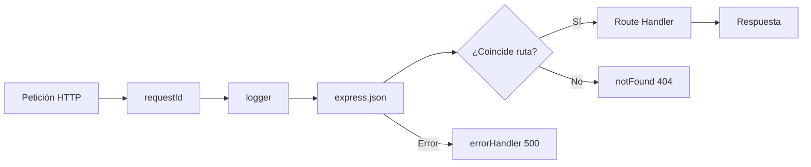

# Actividad 1: Orden de ejecución del middleware

**Objetivo**: Visualizar y comprender el orden en que se ejecuta el middleware en Express.

> **Dónde trabajas**: en el **repositorio del backend** de tu equipo — el
> repositorio aparte donde construyes el proyecto Node.js + Express, no el
> repositorio de documentación. Mantén la estructura `src/` que creaste en
> el Topic 03.

> **En tu repositorio del backend**: observa los escenarios en el proyecto
> de referencia y, a medida que añadas los middlewares (Actividades 3 y 4),
> replica el mismo orden en el `createApp()` de tu `src/app.ts` y anota las
> respuestas observadas.
>
> **Avance de vuestra API**: deja fijado el orden por el que pasará **toda**
> petición a documents/questions: `requestId → logger → express.json →
> routers → notFound → errorHandler`.

## Apuntes: qué es el middleware y por qué importa el orden

En Express, una petición HTTP entra y **pasa por una cadena de
funciones**. Cada función de esa cadena es un *middleware*: Cada middleware recibe la
petición (`req`), la respuesta (`res`) y un tercer argumento `next` con el
que **cede el turno** al siguiente. La regla fundamental:

> El orden en que se registra el middleware con `app.use()` es el orden en
> que se ejecuta para cada petición. **Solo se llega a un paso si todos los
> anteriores llamaron a `next()`.**

En el proyecto de referencia, `src/app.ts` registra los middlewares en este
orden exacto:

```ts
app.use(requestId);        // 1) asigna un requestId a la petición (el primero: todos los demás lo usan)
app.use(logger);           // 2) registra un log al terminar la petición
app.use(express.json());   // 3) parsea el body JSON (convierte el body en `req.body`; si no lo hiciéramos, `req.body` sería `undefined`)

app.use('/health', healthRouter);          // 4) rutas de health (entra aquí si la URL empieza por /health)
app.use('/api/v1/articles', articlesRouter); // 5) rutas de articles (entra aquí si la URL empieza por /api/v1/articles)

app.use(notFound);         // 6) 404 — SOLO si ninguna ruta ha respondido
app.use(errorHandler);     // 7) errores — SIEMPRE el último
```

En vuestro backend, en el paso 5 estarán vuestros routers de
`/api/v1/admin/documents` y `/api/v1/questions`.

Dos consecuencias que tenéis que entender:

1. **Express recorre la cadena en orden**: si `logger` no llamara a
   `next()`, ninguna petición llegaría nunca a las rutas. Y como
   `express.json()` va **después** de `requestId` y `logger`, una petición
   con un JSON mal escrito también queda identificada y registrada.
2. **El orden 404/500 importa**: `notFound` va **después** de las rutas
   (para atrapar solo lo que ninguna ruta respondió) y `errorHandler` va
   **el último** (para recoger los errores que `next(err)` propaga).

‼️‼️‼️ Muy importante ‼️‼️‼️

El `errorHandler` es especial: Express lo reconoce porque su firma tiene
**cuatro parámetros** `(err, req, res, next)` y, cuando un middleware llama
a `next(err)` con un argumento, Express salta directamente al primer
manejador de errores, ignorando los middlewares normales intermedios.

## Qué sucede cuando llega una petición



## EJERCICIOS: 

Arranca el proyecto de referencia (`code/backend/`, recurso `articles`) y,
utilizando Bruno, simula los siguientes escenarios. Escribe qué respuesta
devuelve el backend y por qué:

- Un `POST /api/v1/articles` con un body JSON válido (`{"title":"Hola"}`). Observa el orden de ejecución de los middlewares y la respuesta final.
- Un `POST /api/v1/articles` con un body que **no es JSON válido** (por ejemplo `{malo`). Observa cómo se maneja el error y qué middlewares se ejecutan.
- Una petición a una ruta no existente, como `/api/unknown`. Observa cómo se maneja el 404 y qué middlewares se ejecutan.
- Una petición a una ruta que existe pero no tiene un método válido, como `PUT /api/v1/articles/123`. Observa cómo se maneja el error y qué middlewares se ejecutan.
- Un `POST /api/v1/articles` con un JSON bien escrito pero sin el dato obligatorio (`{}`). Observa cómo se maneja el error y qué middlewares se ejecutan.


