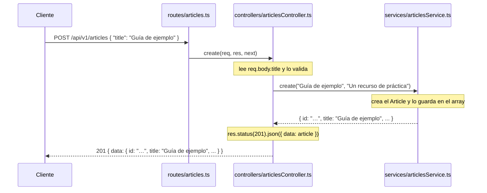

# Actividad 2: Separación en rutas, controladores y servicios

**Objetivo**: Refactorizar el código inline de vuestros routers del Topic 04 en
las tres capas arquitectónicas.

> **Dónde trabajas**: en el **repositorio del backend** de tu equipo — el
> repositorio aparte donde construyes el proyecto Node.js + Express, no el
> repositorio de documentación. Crea las dos capas nuevas dentro de su `src/`
> (`src/controllers/` y `src/services/`); `src/routes/` ya existe desde el
> Topic 03.

> **En tu repositorio del backend**: partes de `src/routes/documents.ts` y
> `src/routes/questions.ts` del Topic 04, con toda la lógica dentro de cada
> ruta. El ejemplo de esta actividad trabaja con `articles` como recurso de
> práctica (mismo perfil que un documento: `id`, `title`, `description`,
> `createdAt`), pero **no** con `documents`: se parece a lo que necesitáis
> sin ser la solución. Aplica el patrón a vuestros propios recursos.
>
> **Avance de vuestra API**: en estas carpetas vivirán los controladores y
> servicios de **documents** y **questions** (cuyo contrato diseñaréis en el
> Topic 06), con servicios en TypeScript puro, sin Express y testeables sin
> HTTP.

## Apuntes: por qué tres capas y qué hace cada una

El código del Topic 04 mezcla tres responsabilidades en un solo fichero:
define rutas, gestiona `req`/`res` y guarda datos en un array. Las separa
en **tres capas** que solo se comunican en un sentido:

```
routes/  ──►  controllers/  ──►  services/
(qué URL    (qué hace con    (lógica de negocio
 responde)   req/res)         y datos)
```

| Capa | Responsabilidad | Qué conoce | Depende de |
|------|-----------------|------------|------------|
| **routes/** | Mapear URLs a funciones del controlador | Solo Express `Router` y controladores | Controllers |
| **controllers/** | Recibir `req`/`res`, validar entrada, llamar al servicio, traducir errores, responder | Express `Request`/`Response`/`NextFunction` y servicios | Services |
| **services/** | Lógica de negocio y acceso a datos: gestionar el array, crear elementos | **Nada de Express** | — |

La regla de oro del ejercicio:

> **El servicio no debe saber que Express existe.** No importa `Router`,
> `Request`, `Response` ni `NextFunction`; no usa `req`, `res` ni `next`.
> Recibe valores planos (un `string`, un `number`) y devuelve datos (un
> `Article`).

¿Por qué vale la pena? Porque la lógica de negocio queda **testeable sin
HTTP** (Topic 08): podrás llamar a `articlesService.create('x', 'y')` en un
test sin levantar un servidor. Y porque, cuando cambie algo de HTTP (p. ej.
cómo se valida), tocarás solo el controlador, no tu lógica.

## Ejemplo: de un router con todo dentro a tres capas

Este es el router de `articles` tal como quedaría en el Topic 04: **la misma
forma** que vuestro `src/routes/documents.ts`. Rutas, `req`/`res` y datos,
todo en un fichero:

```typescript
// src/routes/articles.ts — ANTES (estilo Topic 04)
import { randomUUID } from 'node:crypto';
import { Router } from 'express';

interface Article {
  id: string;
  title: string;
  description: string;
  createdAt: string;
}

export const articlesRouter = Router();

const articles: Article[] = [];

articlesRouter.get('/', (req, res) => {
  const page = Number(req.query.page ?? 1);
  const limit = Number(req.query.limit ?? 20);
  const start = (page - 1) * limit;
  res.json({
    data: articles.slice(start, start + limit),
    pagination: { page, limit, total: articles.length },
  });
});

articlesRouter.post('/', (req, res) => {
  const { title, description } = req.body;
  if (!title) {
    return res.status(400).json({ error: 'MISSING_TITLE' });
  }
  const article: Article = {
    id: randomUUID(),
    title,
    description: description ?? '',
    createdAt: new Date().toISOString(),
  };
  articles.push(article);
  res.status(201).json({ data: article });
});

articlesRouter.get('/:articleId', (req, res) => {
  const article = articles.find((item) => item.id === req.params.articleId);
  if (!article) {
    return res.status(404).json({ error: 'NOT_FOUND' });
  }
  res.json({ data: article });
});

// ...y el PATCH /:articleId, con la misma mezcla.
```

Las **URLs no cambian** con la refactorización: `app.ts` sigue montando
`app.use('/api/v1/articles', articlesRouter)` y los clientes (curl, Bruno) no
notan nada. Lo que cambia es **dónde** vive cada cosa.

## Apuntes: cómo debe quedar, pieza a pieza

### `src/services/articlesService.ts` — la lógica pura

Gestiona el array (que vive **aquí**, no en las rutas) y expone funciones
que reciben y devuelven datos planos. Nada de Express:

```typescript
import { randomUUID } from 'node:crypto';

export interface Article {
  id: string;
  title: string;
  description: string;
  createdAt: string;
}

export interface ArticleChanges {
  title?: string;
  description?: string;
}

const articles: Article[] = [];

export function list(page: number, limit: number) {
  const start = (page - 1) * limit;
  return {
    data: articles.slice(start, start + limit),
    pagination: { page, limit, total: articles.length },
  };
}

export function getById(id: string): Article | undefined {
  return articles.find((article) => article.id === id);
}

export function create(title: string, description: string): Article {
  const article: Article = {
    id: randomUUID(),
    title,
    description,
    createdAt: new Date().toISOString(),
  };
  articles.push(article);
  return article;
}

export function update(id: string, changes: ArticleChanges): Article | undefined {
  const article = getById(id);
  if (!article) {
    return undefined;
  }
  if (changes.title !== undefined) {
    article.title = changes.title;
  }
  if (changes.description !== undefined) {
    article.description = changes.description;
  }
  return article;
}
```

Fíjate en `list(page, limit)`: el servicio recibe **números**. Convertir el
texto de `req.query` a número es trabajo HTTP, así que lo hace el controlador.

### `src/controllers/articlesController.ts` — el traductor HTTP

Recibe `req/res/next`, valida la entrada, llama al servicio y responde. Los
errores se notifican con `AppError` y se propagan con `next(err)` (el
`errorHandler` de la Actividad 3 los convertirá en la respuesta de error):

```typescript
import type { Request, Response, NextFunction } from 'express';
import * as articlesService from '../services/articlesService.js';
import { AppError } from '../errors/AppError.js';

export function list(req: Request, res: Response, next: NextFunction): void {
  try {
    const page = Number(req.query.page ?? 1);
    const limit = Number(req.query.limit ?? 20);
    res.json(articlesService.list(page, limit));
  } catch (err) {
    next(err);
  }
}

export function getById(req: Request, res: Response, next: NextFunction): void {
  try {
    const article = articlesService.getById(String(req.params.articleId));
    if (!article) {
      throw new AppError(404, `Article with id '${req.params.articleId}' not found`, 'NOT_FOUND');
    }
    res.json({ data: article });
  } catch (err) {
    next(err);
  }
}

export function create(req: Request, res: Response, next: NextFunction): void {
  try {
    const { title, description } = req.body;
    if (!title || typeof title !== 'string') {
      throw new AppError(400, 'Missing required field: title', 'BAD_REQUEST');
    }
    const article = articlesService.create(
      title.trim(),
      typeof description === 'string' ? description.trim() : '',
    );
    res.status(201).json({ data: article });
  } catch (err) {
    next(err);
  }
}

export function update(req: Request, res: Response, next: NextFunction): void {
  try {
    const { title, description } = req.body;
    const article = articlesService.update(String(req.params.articleId), { title, description });
    if (!article) {
      throw new AppError(404, `Article with id '${req.params.articleId}' not found`, 'NOT_FOUND');
    }
    res.json({ data: article });
  } catch (err) {
    next(err);
  }
}
```

> **Por qué `try/catch` + `next(err)`**: el controlador no responde los
> errores a mano; los **lanza** y `next(err)` se los entrega al manejador de
> errores central, que decide el status y el cuerpo. Así ningún controlador
> repite `res.status(400).json(...)`. (Express 5 también reenvía solo un
> `throw` síncrono o una promesa rechazada, pero con `next(err)` el camino del
> error queda a la vista y funciona igual en cualquier versión.)

> `AppError` todavía no existe: lo crearás en la Actividad 3. Si quieres
> probar antes, crea ya `src/errors/AppError.ts` con el código que aparece
> en esa actividad.

### `src/routes/articles.ts` — el mapeo URL → controlador

El mismo fichero de antes, pero ahora solo define qué URL llama a qué función
del controlador:

```typescript
import { Router } from 'express';
import * as articlesController from '../controllers/articlesController.js';

export const articlesRouter = Router();

articlesRouter.get('/', articlesController.list);
articlesRouter.post('/', articlesController.create);
articlesRouter.get('/:articleId', articlesController.getById);
articlesRouter.patch('/:articleId', articlesController.update);
```

`src/app.ts` **no cambia**: sigue montando el mismo router en el mismo
prefijo.

### EJEMPLO: el viaje de una petición

Para fijar la relación entre las tres capas, seguid una única petición de
principio a fin. Suponed que llega:

```http
POST /api/v1/articles
{ "title": "Guía de ejemplo", "description": "Un recurso de práctica" }
```



## Ejercicio: aplícalo a documents y questions

1. **Documents**: crea `src/services/documentsService.ts` (con el array y sus
   documentos iniciales, `list(page, limit)`, `getById`, `create` y `update`)
   y `src/controllers/documentsController.ts` (`list`, `getById`, `create`,
   `update`). Deja `src/routes/documents.ts` con solo cuatro líneas de
   mapeo, como el de `articles`.
2. **Questions**: crea `src/services/questionsService.ts` con una función
   `answerQuestion()` que devuelva la respuesta simulada fija (`answer` y
   `citations`), y `src/controllers/questionsController.ts` con una función
   `ask` que compruebe la pregunta (lanzando `AppError` si no es válida),
   llame al servicio y responda `200` con `{ data: ... }`. `src/routes/questions.ts` queda en una línea:
   `questionsRouter.post('/', questionsController.ask)`.
3. Comprueba que **ninguna URL ha cambiado**: repite las peticiones de la
   Actividad 04 del Topic 04 y deben dar los mismos códigos de estado. Las
   respuestas de error cambiarán de forma cuando termines la Actividad 3.
4. Comprueba que ningún fichero de `src/services/` importa `express`.
5. Pasa `npm run typecheck` y `npm run lint`.
